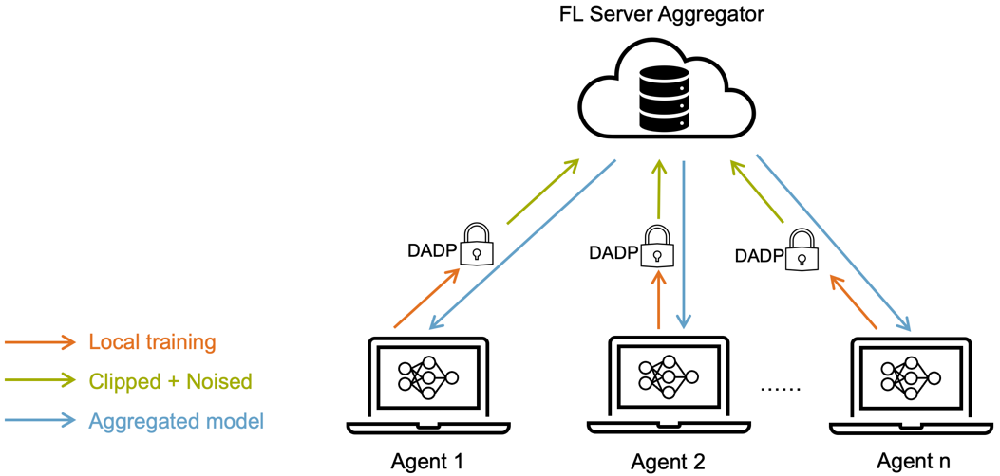
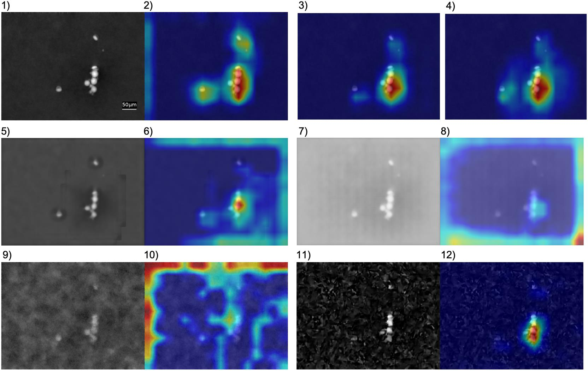

# FL-YOLO-DADP

Official code for the paper

> **Improved Federated Learning with Differential Privacy for YOLO Detector on Phase Images**
> Qianyu Chen, Kerem Delikoyun, Oliver Hayden, Klaus Diepold
> *Proceedings of the 12th International Conference of Control Systems, and Robotics (CDSR 2025)*, London, UK, July 13–15, 2025. Paper No. 129.
>
> [Paper (PDF)](https://www.avestia.com/CDSR2025_Proceedings/files/paper/CDSR_129.pdf) · [DOI: 10.11159/cdsr25.129](https://doi.org/10.11159/cdsr25.129)

Federated learning (FL) offers a decentralized paradigm for privacy-preserving medical imaging, yet static differential privacy (DP) often degrades model utility. We propose FL-YOLO-DADP, integrating dynamic adaptive DP (DADP) with YOLOv8n for hematological cell detection in digital holographic microscopy. Unlike static DP-FL, DADP adaptively scales noise and clipping based on training phases, maintaining high accuracy while guaranteeing (ε, δ)-DP. For comparison, we also implement four generative models (encoder-decoder, GANs, DDPM, and ControlNet-img2img) to synthesize phase images and train YOLOv8n centrally on each synthetic set. Our experiments on a multi-client dataset demonstrate that FL-YOLO-DADP generally outperforms both centralized training on synthetic images and naive federated baselines, with 46.8% higher mAP50 than the GANs-generated train set. Further, Eigen-CAM visualizations confirm that critical morphological features are retained, showcasing the framework's robustness in small-data and heterogeneous settings.

**Keywords:** Federated Learning, YOLO, Dynamic Adaptive Differential Privacy, Phase Image

<p align="center">
  
  <br><em>Fig. 1: FL-YOLO-DADP workflow.</em>
</p>

## Results

All results below are reproduced from the paper. Three agents each hold 2,400 training and 240 validation frames (384×512 px, up to 30 cells per frame); all models are evaluated on a test set of 240 annotated phase images. Benchmark and generative-model detectors are trained for 20 epochs; federated models for 20 rounds of 1 local epoch.

**Table 1: Comparative experimental results on our customized dataset.**

| Model | Precision | Recall | AP50 (all) | AP50 (RBC) | AP50 (WBC) | AP50 (PLT) |
|---|---:|---:|---:|---:|---:|---:|
| ***Benchmark*** | | | | | | |
| YOLOv8n | 0.693 | 0.85 | 0.856 | 0.81 | 0.959 | 0.799 |
| ***Generative models*** | | | | | | |
| Encoder-decoder | 0.358 | 0.629 | 0.518 | 0.207 | 0.906 | 0.441 |
| GANs | 0.856 | 0.305 | 0.327 | 0.003377 | 0.871 | 0.106 |
| DDPM | 0.911 | 0.281 | 0.315 | 0.0264 | 0.813 | 0.107 |
| Controlnet-img2img | 0.383 | 0.556 | 0.459 | 0.445 | 0.838 | 0.0928 |
| ***Federated learning-based models*** | | | | | | |
| FedAvg-YOLO | 0.547 | 0.7 | 0.672 | 0.612 | 0.868 | 0.536 |
| FedMedian-YOLO | 0.555 | 0.688 | 0.673 | 0.605 | 0.84 | 0.574 |
| ***Ours*** | | | | | | |
| **FL-YOLO-DADP** | **0.375** | **0.501** | **0.48** | **0.323** | **0.718** | **0.399** |

FL-YOLO-DADP improves mAP50 over the GANs-generated training set by 46.8% across all classes and by 276.4% for platelets (PLT).

<p align="center">
  
</p>

*Fig. 2: 1) Original phase image, 2) Eigen-CAM explains YOLOv8n trained on original phase images, 3) Eigen-CAM explains FedMedian-YOLO trained on original phase images, 4) Eigen-CAM explains FL-YOLO-DADP trained on original phase images, 5) Encoder-decoder-generated image, 6) Eigen-CAM explains YOLOv8n trained on encoder-decoder-generated images, 7) GANs-generated image, 8) Eigen-CAM explains YOLOv8n trained on GANs-generated images, 9) DDPM-generated image, 10) Eigen-CAM explains YOLOv8n trained on DDPM-generated images, 11) ControlNet-latent-img2img-generated image, 12) Eigen-CAM explains YOLOv8n trained on ControlNet-latent-img2img-generated images.*

## Installation

Requirements: Linux, Python 3.10 and an NVIDIA GPU with a CUDA 11.8-compatible driver. The steps below install the tested environment (PyTorch 2.2.1, ultralytics 8.1.34, Flower 1.11.1); the experiments ran on one Tesla V100S (32 GB).

1. **Clone the repository**

   ```bash
   git clone https://github.com/chenqianyu/FL-YOLO-DADP.git
   cd FL-YOLO-DADP
   ```

2. **Create an environment** (venv or conda)

   ```bash
   python3.10 -m venv .venv && source .venv/bin/activate
   # or: conda create -n fl-yolo-dadp python=3.10 && conda activate fl-yolo-dadp
   python -m pip install --upgrade pip
   ```

3. **Install PyTorch for your CUDA version** (CUDA 11.8 shown)

   ```bash
   pip install torch==2.2.1 torchvision==0.17.1 --index-url https://download.pytorch.org/whl/cu118
   ```

4. **Install the remaining dependencies**

   ```bash
   pip install -r requirements.txt
   ```

5. **Check the installation**

   ```bash
   python fl/run_fl.py --help
   python fl/dp.py --noise-multiplier 1e-4     # prints (epsilon, delta) for a DADP schedule
   ```

There is no build or `pip install` step for the repository itself: all scripts run from the repository root. YOLOv8n is trained from scratch, so no pretrained detector weights are needed. The ControlNet notebook downloads Stable Diffusion v1.5 and `lllyasviel/control_v11p_sd15_canny` from the Hugging Face Hub on first use (about 5 GB).

## Acknowledgements

This research is supported by the Singapore National Research Foundation (No. NRF2019-THE002-0008). The code builds on [Ultralytics YOLO](https://github.com/ultralytics/ultralytics) (AGPL-3.0), [Flower](https://github.com/adap/flower), [Opacus](https://github.com/pytorch/opacus) and [diffusers](https://github.com/huggingface/diffusers). Eigen-CAM is from [rigvedrs/YOLO-V11-CAM](https://github.com/rigvedrs/YOLO-V11-CAM) (MIT; see `explainability/third_party/yolo_cam/LICENSE`).

## Citation

```bibtex
@inproceedings{chen2025fldadp,
  title     = {Improved Federated Learning with Differential Privacy for {YOLO} Detector on Phase Images},
  author    = {Chen, Qianyu and Delikoyun, Kerem and Hayden, Oliver and Diepold, Klaus},
  booktitle = {Proceedings of the 12th International Conference of Control Systems, and Robotics (CDSR 2025)},
  pages     = {129-1--129-10},
  year      = {2025},
  address   = {London, United Kingdom},
  doi       = {10.11159/cdsr25.129}
}
```
